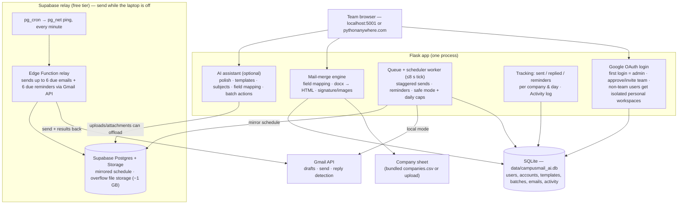

# CampusMail AI — the outreach team

One email + one company sheet in → **one personalised email per contact** out (right name, company, images, links, attachments, signature). Then save as Gmail drafts, schedule exact send times, auto-remind non-repliers, track sent/replied per company and day, and optionally let AI polish copy, write templates and suggest field mappings.

**Live:** [https://aicampusmail.pythonanywhere.com](https://aicampusmail.pythonanywhere.com) — public deployment on PythonAnywhere (free tier; Google login gates it; the team shares one workspace, other sign-ins get an isolated personal workspace). Also runs fully local in seconds: `./run.sh` → http://localhost:5001.

## What it does

- **Mail merge with real content** — text, HTML, Word (`docx_convert.py` keeps bold/colour/bullets/links/images), per-contact field mapping, signature and template images.
- **Drafts first** — every batch saves as Gmail drafts for review in Gmail before anything goes out.
- **Real scheduling** — a built-in worker (or the cloud relay) sends at the exact date/time on any Gmail account; stop / reschedule / delete / save-as-draft anytime.
- **Auto-reminders** — each mail carries pre-rendered reminder subject/body; reminder N fires at `sent_at + N × reminder_days` with no reply; auto reply detection cancels them.
- **Tracking** — sent / replied / reminders per company and per day, with a full Activity log of who did what.
- **AI assistant** (optional, OpenAI-compatible) — chat for status, create campaigns/templates, list sheets, generate + schedule batches from a serial range (it never sends immediately).
- **Safety rails** — safe mode (drafts only, default), daily live-send cap (default 100), staggered sends, typed confirmations. Nothing sends without a deliberate, confirmed action.

## System design



**Key decisions**

- **One process, one SQLite file** — the whole platform (pages, APIs, scheduler worker, reports) is a single Flask app; data lives in `data/campusmail_ai.db`. Tenants: the team shares one workspace; pending/declined sign-ins get their own DB + folders (`data/workspaces/`).
- **Cloud relay, not Gmail "send later"** — scheduling, stop/reschedule/delete stay on the platform and are mirrored to Supabase instantly; a per-minute cron sends due mail from the cloud, so the laptop can be asleep. Limits: 6 emails + 6 reminders/minute; safe mode still blocks the cloud. Relay code in `supabase/`.
- **Storage that scales on the free tier** — 512 MB PA disk is fine for the DB (a rendered email is a few KB); batch attachments/images can offload to Supabase Storage (~1 GB) via Settings → File storage, keeping PA usage flat.
- **Auth model** — pinned admin (`PINNED_ADMIN` in `db.py`) + approve/invite flow; every action lands in the Activity log with the person's name.

## Run it

```bash
./run.sh                 # Mac/Linux — creates .venv, installs, starts on :5001
# Windows: run.bat
CAMPUSMAIL_AI_PORT=8080 ./run.sh     # custom port (5001 is intentional — 5000 is macOS AirPlay)
```

**One-time setup (admin, ~10–15 min, no installs):** create a Google Cloud project with (A) a **Web OAuth client** for team sign-in (redirect `http://localhost:5001/api/google/callback`, or `https://<you>.pythonanywhere.com/api/google/callback` on the hosted instance) and (B) a **Desktop OAuth client** for Gmail sending (JSON pasted into Settings), then enable the Gmail API. Full steps: `DEPLOY.md` + in-app Settings.

**Demo data for a scratch instance:** `CAMPUSMAIL_AI_PORT=5099 CAMPUSMAIL_AI_DEV_LOGIN=you@example.com ./run.sh` then `.venv/bin/python scripts/seed_demo.py --fresh --yes`.

## Troubleshooting (short version)

- *Port in use* → `lsof -i :5001` or pick another port. *redirect_uri_mismatch* → exact redirect URI in the OAuth client. *Nothing sends on time* → laptop was asleep; it sends on the next tick (or marks missed per Settings). *Reset everything* → stop the app, delete `data/campusmail_ai.db*`. Full list in section 6 below → see `DEPLOY.md`.

## Repository layout

```
app.py            Flask app: pages, APIs, scheduler worker, reports, reminders
db.py             SQLite schema + helpers + tenancy (PINNED_ADMIN)
filestore.py      local disk or Supabase Storage (toggle in Settings)
gmail_client.py   Gmail OAuth: drafts/send, attachments, reply detection
docx_convert.py   Word → email HTML with field detection
ai_client.py      OpenAI-compatible calls (writer, polisher, subjects, mapping)
supabase/         cloud relay: schema + edge function + cron wiring
ui/ static/       Jinja pages + vanilla JS (app.css, app.js, guide screenshots)
run.sh run.bat    launchers (auto-venv) · wsgi.py — PythonAnywhere entry point
data/             campusmail_ai.db, companies.csv, attachments/, workspaces/
```

**Docs:** [PythonAnywhere hosting guide](DEPLOY.md) · [features reference](docs/FEATURES.md) · [cloud relay v2](docs/SYNC_V2.md) · [UI changelog](CHANGELOG-UI.md)
